<!-- Header: animated wave + ASCII background (assets/header.svg) -->

  

  

  

## 🧑‍💻 About Me

  

## 🧰 `~/toolbox`

  

<table width="100%">
  <thead>
    <tr>
      <th align="left" width="22%">Domain</th>
      <th align="center" width="40%">Stack &amp; Tooling</th>
      <th align="left" width="38%">Tools &amp; Concepts</th>
    </tr>
  </thead>
  <tbody>
    <tr>
      <td>🌐 <b>Frontend</b></td>
      <td align="center">
        
      </td>
      <td>
        
        
        
      </td>
    </tr>
    <tr>
      <td>⚙️ <b>Backend</b></td>
      <td align="center">
        
      </td>
      <td>
        
        
        
      </td>
    </tr>
    <tr>
      <td>🗄️ <b>Database</b></td>
      <td align="center">
        
      </td>
      <td>
        
        
      </td>
    </tr>
    <tr>
      <td>🧪 <b>Testing</b></td>
      <td align="center">
         
      </td>
      <td>
        
        
        
      </td>
    </tr>
    <tr>
      <td>🚀 <b>Tools &amp; Deployment</b></td>
      <td align="center">
        
      </td>
      <td>
        
        
        
      </td>
    </tr>
    <tr>
      <td>🤖 <b>AI-Assisted Development</b></td>
      <td align="center">
        
        
        
      </td>
      <td>
        
        
      </td>
    </tr>
  </tbody>
</table>

ℹ️ Icons are loaded from external badge/icon services. This list reflects technologies and tools encountered in my projects and learning, not expert-level proficiency in each.

## 📊 GitHub Stats

  
  

  

  

## 🐍 Contribution Snake

  <picture>
    <source media="(prefers-color-scheme: dark)" srcset="https://raw.githubusercontent.com/Agile4Life/Agile4Life/output/github-snake-dark.svg" />
    <source media="(prefers-color-scheme: light)" srcset="https://raw.githubusercontent.com/Agile4Life/Agile4Life/output/github-snake.svg" />
    
  </picture>

<!-- Footer: animated wave -->

  

